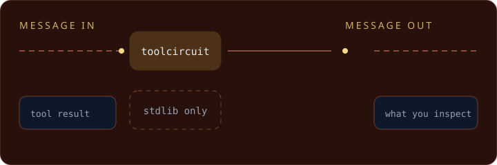

<p align="center">
  
</p>

<p align="center">
  <a href="https://pypi.org/project/toolcircuit/"></a>
  <a href="https://pypi.org/project/toolcircuit/"></a>
  <a href="https://pypi.org/project/toolcircuit/"></a>
  <a href="https://github.com/sandeshbagmare/toolcircuit/actions/workflows/ci.yml"></a>
  <a href="https://github.com/sandeshbagmare/toolcircuit/blob/main/LICENSE"></a>
  <a href="https://sandeshbagmare.github.io/toolcircuit/"></a>
  <a href="https://pypi.org/project/toolcircuit/"></a>
</p>

<h3 align="center">stop retrying a tool that is down</h3>
<p align="center"><em>Standard library only. No runtime dependencies. Python 3.9+.</em></p>

<p align="center">
  
</p>

## Install

```console
pip install toolcircuit
```

## Use

```python
from toolcircuit import CircuitOpen, Policy, ToolCircuit

circuit = ToolCircuit(
    default=Policy(failure_threshold=3, cooldown=30),
    policies={"search": Policy(failure_threshold=2, cooldown=120)},
)

def call_tool(name, tool, **arguments):
    try:
        return circuit.call(name, tool, **arguments)
    except CircuitOpen as error:
        return {"error": str(error), "retry_after": error.retry_after}
    except Exception as error:
        return {"error": f"{name} failed: {error}"}
```

Reading it back:

```python
circuit.state("search")        # 'closed' | 'open' | 'half-open'
circuit.allow("search")        # False while open
circuit.failures("search")     # consecutive failures
circuit.retry_after("search")  # seconds until the next trial
circuit.report()               # {"search": {"state": "open", "failures": 3, …}}
circuit.reset()                # new run
```

## How the states work

| state | meaning | calls allowed |
| ----- | ------- | ------------- |
| `closed` | healthy, failures below the threshold | yes |
| `open` | threshold reached | no, `CircuitOpen` with a wait time |
| `half-open` | cooldown has passed | one trial |

A success anywhere closes the circuit and resets the failure count. A failure in
`half-open` reopens it for another full cooldown — the service had its chance.

The clock is injectable, which is how the tests avoid sleeping:

```python
now = 0.0
circuit = ToolCircuit(clock=lambda: now)
```

## Rules

- The breaker is per tool name, per process. A shared breaker across workers needs a
  shared store, which is a different library on purpose: a breaker that needs a network
  round trip is a breaker that breaks the run when that network is down.
- `call` re-raises the original exception after counting it, so your own error handling
  keeps working; only the refusal case is a new exception type.
- Count only failures that say something about the *service*. A bad argument is not an
  outage, so catch that before calling `call`, not after.
- `cooldown` is a floor, not a schedule: nothing wakes up to close the circuit, it closes
  on the first success after a cooldown, or on `reset()`.

## Limits

- No exponential growth of the cooldown between reopens, and no jitter. If you need
  either, wrap `Policy` and replace the breaker object.
- No bulkheads or concurrency limits: this decides *whether* to call, not *how many* at
  once.
- State dies with the process. That is the right default for a run, and the wrong one for
  a long-lived service — persist `report()` if you need that.

## Development

```console
python -m venv .venv
.venv/bin/pip install -e ".[test]"
.venv/bin/pytest
```

The suite covers every line of the package (`pytest --cov --cov-branch`), and the
examples in the docstrings run as tests through `--doctest-modules`.

## License

MIT.
